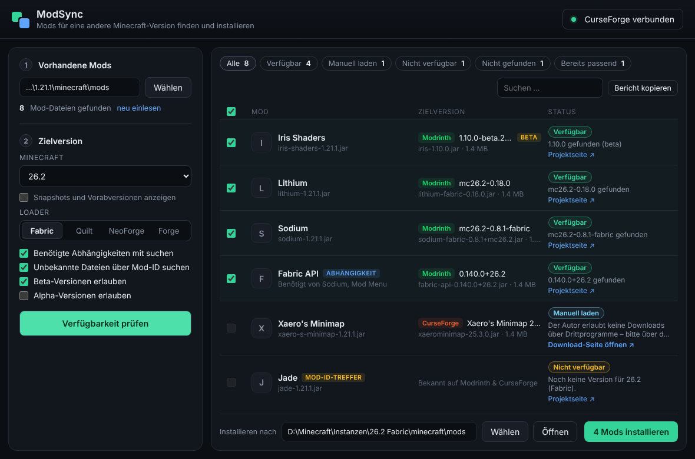
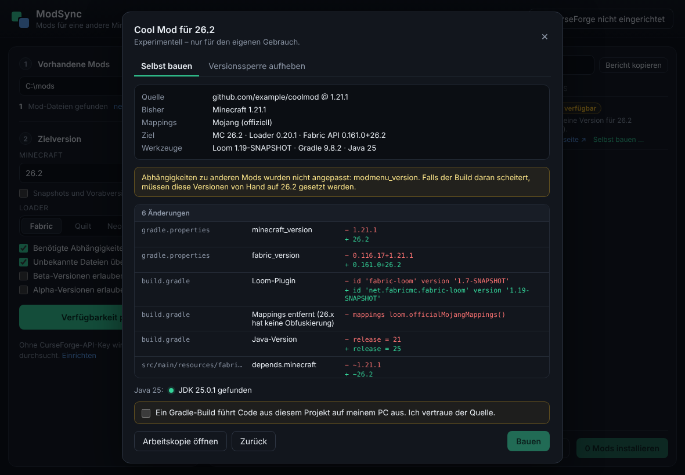

# ModSync

ModSync ist eine Desktop-App für Windows 10 und 11. Sie nimmt den `mods`-Ordner einer bestehenden Minecraft-Instanz, sucht jede Mod auf **Modrinth** und **CurseForge** und zeigt, ob es eine Version für deine Ziel-Minecraft-Version und den gewählten Loader gibt. Die gefundenen Mods lädt sie in einen Ordner deiner Wahl.

Gibt es eine Mod nicht für die Zielversion, kann ModSync versuchen, sie **selbst zu bauen** (experimentell, siehe unten).



## Funktionen

- **Mods per Prüfsumme erkennen:** SHA-512 für Modrinth, Fingerprint (MurmurHash2) für CurseForge. Dateinamen spielen keine Rolle.
- **Fallback über die Mod-ID:** Wird eine Datei nicht per Prüfsumme erkannt, wird über die Mod-ID aus `fabric.mod.json`, `quilt.mod.json` oder `mods.toml` gesucht. Solche Treffer sind als „Mod-ID-Treffer“ markiert und sollten kurz geprüft werden.
- **Zielauswahl:** beliebige Minecraft-Version (Liste live von Modrinth, Snapshots optional) und Loader (Fabric, Quilt, NeoForge, Forge). Beta- und Alpha-Versionen kannst du freischalten.
- **Abhängigkeiten:** Pflicht-Abhängigkeiten wie Fabric API werden automatisch gefunden und mit angeboten.
- **Status pro Mod:** Verfügbar, Bereits passend, Manuell laden, Nicht verfügbar oder Nicht gefunden.
- **Sichere Installation:**
  - Nur HTTPS-Downloads.
  - Jede Datei wird gegen ihre SHA-1-Prüfsumme geprüft.
  - Vorhandene Dateien werden nie überschrieben.
  - Kein Schreiben außerhalb des Zielordners.
- **Gesperrte CurseForge-Downloads:** Manche Autoren verbieten Downloads über Drittprogramme. ModSync zeigt dann einen Link zur Download-Seite an, statt die Sperre zu umgehen.
- **Bericht kopieren:** Eine Liste aller Mods mit Status und Link für die Zwischenablage.
- **Sicherer API-Key:** Der CurseForge-API-Key liegt im Windows-Anmeldeinformationsspeicher, nicht in einer Datei.
- **Einstellungen:** Ordner, Version, Loader und Optionen werden gespeichert.

## Selbst bauen (experimentell, ab 0.2)

Bei Mods mit dem Status „Nicht verfügbar“ oder „Nicht gefunden“ erscheint **Selbst bauen …**. Dann passiert Folgendes:

1. **Quelle wählen:** ein GitHub-Repository (wird automatisch von Modrinth, CurseForge oder aus der `fabric.mod.json` übernommen, wenn vorhanden) mit Branch-Vorschlag, oder ein lokaler Projektordner.
2. **Versionen holen:** ModSync lädt die offizielle Vorlage für die Zielversion. Das ist der passende Branch von [FabricMC/fabric-example-mod](https://github.com/FabricMC/fabric-example-mod) und enthält Loader, Fabric API, Loom, Gradle und Java.
3. **Nur die Build-Konfiguration anpassen**, und zwar in einer Arbeitskopie:
   - `gradle.properties` bzw. `gradle/libs.versions.toml`: Minecraft, Loader, Fabric API, Loom, ggf. Yarn
   - `build.gradle(.kts)`:
     - Loom-Plugin
     - Java-Version
     - bei 26.x zusätzlich: Mappings-Zeile entfernen und `modImplementation` → `implementation`
   - `gradle-wrapper.properties`: Gradle-Version
   - `fabric.mod.json`: `minecraft`, `fabricloader`, `java`

   Alle Änderungen werden vor dem Build angezeigt. **Am Java-Code ändert ModSync nichts.**
4. **Bauen** mit `gradlew build`, Live-Log und Abbrechen-Knopf. Fehlt das passende JDK, kann ModSync Eclipse Temurin herunterladen.
5. **Ergebnis:**
   - **Erfolg:** Eine JAR (`…+mc26.2-modsync.jar`). Sie ist kompiliert, aber im Spiel noch nicht getestet.
   - **Fehler:** Eine Liste der Code-Stellen, die nicht mehr passen.



**Was nicht automatisch geht** (wird vorher erkannt und erklärt):
- Mods mit **Yarn-Namen** → 26.x: Ab 26.1 gibt es nur noch Mojang-Namen. Dafür müsste der komplette Code umbenannt werden.
- **Multiloader-Projekte** (Architectury)
- **Rückportierung** von 26.x auf 1.x
- Projekte **ohne Gradle-Wrapper**

**Realistisch:** Kleine Versionssprünge bei einfachen Mods klappen oft. Bei großen Sprüngen scheitert der Build meistens an geänderten Minecraft-APIs. Dann zeigt ModSync, welche Stellen im Code angepasst werden müssen.

**Sicherheit:** Ein Gradle-Build führt Code aus dem Projekt aus. ModSync baut deshalb erst nach ausdrücklicher Bestätigung. Nur Quellen nutzen, denen du vertraust.

**Versionssperre aufheben:** Für vorhandene Fabric-JARs gibt es als zweite Option die offizielle Fabric-Funktion [Dependency Overrides](https://docs.fabricmc.net/players/troubleshooting/dependency-overrides). ModSync kopiert die unveränderte JAR und schreibt einen Eintrag in `config/fabric_loader_dependencies.json`. Das funktioniert nur bei kleinen Sprüngen. Bei 1.x → 26.x wird es abgelehnt, weil alte JARs dort grundsätzlich nicht laden.

**Ablage:**
- Arbeitskopien, Logs und gebaute JARs: `%LOCALAPPDATA%\net.dapicu.modsync\builds\`. Die letzten 12 werden behalten.
- Heruntergeladene JDKs: `…\jdks\`

Selbst gebaute Mods nur privat nutzen und nicht weiterverbreiten. Das hängt von der Lizenz der jeweiligen Mod ab.

## Voraussetzungen zum Bauen (einmalig)

1. **Node.js 20 oder neuer:** https://nodejs.org
2. **Rust:** https://rustup.rs (Standardinstallation, Toolchain `stable-x86_64-pc-windows-msvc`).
3. **Microsoft C++ Build Tools:** https://visualstudio.microsoft.com/visual-cpp-build-tools/. Bei der Installation „Desktopentwicklung mit C++“ auswählen.
4. **WebView2:** Ist unter Windows 10 und 11 bereits vorinstalliert.

Alternativ ohne lokale Installation: Das Projekt in ein GitHub-Repository hochladen und unter **Actions → Windows-Build → Run workflow** starten. Der fertige Installer liegt danach als Artefakt „ModSync-Windows“ am Workflow-Lauf.

## Starten und Bauen

```powershell
cd modsync
npm install

# Entwicklungsmodus (Fenster öffnet sich, Änderungen am UI werden live übernommen)
npm run tauri dev

# Fertigen Installer bauen
npm run tauri build
```

Nach `npm run tauri build` liegen hier:

- Installer (NSIS): `src-tauri\target\release\bundle\nsis\ModSync_0.2.0_x64-setup.exe`
- MSI: `src-tauri\target\release\bundle\msi\ModSync_0.2.0_x64_en-US.msi`
- Programm ohne Installation: `src-tauri\target\release\modsync.exe`

Der erste Build dauert einige Minuten, weil alle Rust-Abhängigkeiten kompiliert werden.

## CurseForge einrichten (optional)

Modrinth funktioniert sofort. Für CurseForge braucht man einen eigenen, kostenlosen API-Key:

1. Auf https://console.curseforge.com anmelden.
2. Unter „API keys“ den Key kopieren. Neue Konten müssen eventuell erst freigeschaltet werden.
3. In ModSync oben rechts auf **CurseForge nicht eingerichtet** klicken, den Key einfügen und auf **Speichern** klicken. Der Key wird dabei sofort getestet.

## Benutzung

1. **Vorhandene Mods → Wählen:** z. B. `…\PrismLauncher\instances\<Instanz>\minecraft\mods`
2. Minecraft-Zielversion und Loader wählen.
3. **Verfügbarkeit prüfen**
4. Unten einen **Zielordner** wählen. Nimm am besten den `mods`-Ordner einer neuen, leeren Instanz und nicht den Quellordner, sonst liegen alte und neue Versionen nebeneinander.
5. **Mods installieren**

Bei „Manuell laden“ öffnet der Link die passende Datei-Seite auf CurseForge.

## Wie die Suche funktioniert

1. Alle `.jar`-Dateien im Ordner werden gehasht und ihre Metadaten gelesen.
2. Modrinth bekommt alle SHA-512-Hashes in einem Aufruf (`POST /v2/version_files`). CurseForge bekommt alle Fingerprints (`POST /v1/fingerprints/432`).
3. Für jedes erkannte Projekt werden die Versionen für Zielversion und Loader abgefragt. Gewählt wird die neueste erlaubte Version, Modrinth wird bevorzugt.
4. Pflicht-Abhängigkeiten der gewählten Versionen werden auf die gleiche Weise aufgelöst, in mehreren Runden.

Modrinth-Abfragen laufen ohne Anmeldung. Gesendet wird nur ein User-Agent (`DaPiCu/ModSync/<Version>`).

## Grenzen

- **Keine Portierung:** Gibt es für eine Mod keine Version für die Zielversion, kann ModSync sie nicht erzeugen. Sie wird dann als „Nicht verfügbar“ angezeigt.
- **Andere Quellen:** Mods von GitHub, Discord oder selbst gebaute Mods werden nicht gefunden („Nicht gefunden“).
- **Mod-ID-Treffer:** Treffer über die Mod-ID können in seltenen Fällen eine andere Mod mit gleichem Slug sein. Deshalb sind sie markiert.
- **Kompatibilität untereinander:** ModSync prüft nicht, ob die gefundenen Versionen untereinander kompatibel sind. Es prüft nur Minecraft-Version und Loader.

## Fehlerbehebung

| Problem | Lösung |
|---|---|
| `link.exe not found` beim Bauen | Microsoft C++ Build Tools mit „Desktopentwicklung mit C++“ installieren, dann ein neues Terminal öffnen. |
| `cargo` / `rustc` nicht gefunden | Nach der Rust-Installation ein neues Terminal öffnen oder neu anmelden. |
| „Keine Verbindung zu Modrinth“ | Internet, Proxy oder Firewall prüfen. Die Versionsliste lässt sich mit „erneut versuchen“ neu laden, oder die Version von Hand eintragen. |
| „CurseForge lehnt den API-Key ab“ | Den Key in der CurseForge-Konsole prüfen. Neue Keys sind manchmal erst nach Freischaltung gültig. |
| „Zu viele Anfragen“ | Kurz warten und erneut prüfen (Rate-Limit der Plattform). |
| „Eine andere Datei mit gleichem Namen existiert bereits“ | ModSync überschreibt nichts. Die alte Datei im Zielordner selbst entfernen. |
| „Prüfsumme stimmt nicht“ | Der Download war beschädigt und wurde verworfen. Einfach erneut installieren. |
| Selbst bauen: „Could not resolve …“ | Eine Abhängigkeit (oft eine andere Mod wie Mod Menu) gibt es für die Zielversion nicht. Die Version in `gradle.properties` der Arbeitskopie anpassen, oder die Abhängigkeit entfernen. |
| Selbst bauen: „cannot find symbol“ | Der Code nutzt Minecraft-Funktionen, die es nicht mehr gibt. Das muss im Code angepasst werden. |
| Selbst bauen: erster Build dauert lange | Gradle lädt beim ersten Mal Minecraft und alle Bibliotheken herunter (mehrere Minuten). Danach geht es schneller. |
| „GitHub-Anfragelimit erreicht“ | GitHub erlaubt ohne Anmeldung 60 Anfragen pro Stunde. Kurz warten oder den Quellcode als lokalen Ordner wählen. |

## Entwicklung

```
modsync/
├─ src/                    React-Oberfläche (TypeScript)
│  ├─ App.tsx              Hauptansicht, Ablauf
│  ├─ Results.tsx          Ergebnisliste mit Filtern
│  ├─ SettingsDialog.tsx   CurseForge-Key
│  ├─ BuildDialog.tsx      Selbst bauen / Versionssperre aufheben
│  └─ api.ts               Typen + Aufrufe ins Rust-Backend
└─ src-tauri/              Rust-Backend
   ├─ src/scan.rs          JAR-Scan, Hashes, Metadaten
   ├─ src/modrinth.rs      Modrinth-API + Versionsauswahl
   ├─ src/curseforge.rs    CurseForge-API + Dateiauswahl
   ├─ src/resolve.rs       Erkennung, Suche, Abhängigkeiten
   ├─ src/install.rs       Download, Prüfsumme, Schutz vor Überschreiben
   ├─ src/settings.rs      Einstellungen + Key im Windows-Tresor
   ├─ src/template.rs      Offizielle Versionsvorlage (fabric-example-mod)
   ├─ src/sources.rs       GitHub-Quellcode / lokaler Ordner
   ├─ src/patcher.rs       Build-Konfiguration anpassen, Blocker erkennen
   ├─ src/jdk.rs           JDK finden / herunterladen
   ├─ src/gradle.rs        Build ausführen, Fehler zusammenfassen
   ├─ src/builder.rs       Ablauf „Selbst bauen“
   ├─ src/overrides.rs     Versionssperre per Dependency Override
   └─ tests/               End-to-End-Tests gegen nachgebaute APIs
```

Patcher von Hand auf einen Ordner anwenden (Entwicklerwerkzeug):

```powershell
cargo run --manifest-path src-tauri/Cargo.toml --example patch_dir -- <Projektordner> src-tauri/tests/fixtures/template-26.2
```

Tests ausführen:

```powershell
cargo test --manifest-path src-tauri/Cargo.toml
```

Zu Testzwecken lassen sich die API-Adressen über die Umgebungsvariablen `MODSYNC_MODRINTH_BASE` und `MODSYNC_CURSEFORGE_BASE` umbiegen, der Key über `MODSYNC_CURSEFORGE_KEY`.
